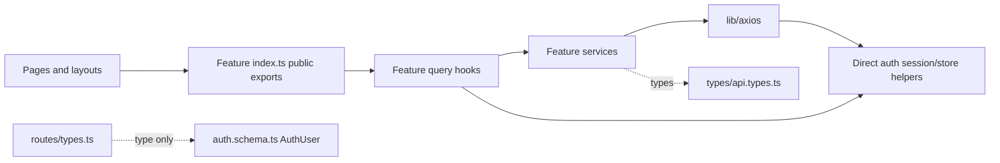
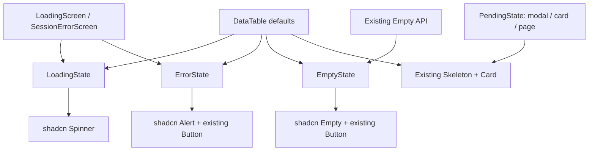
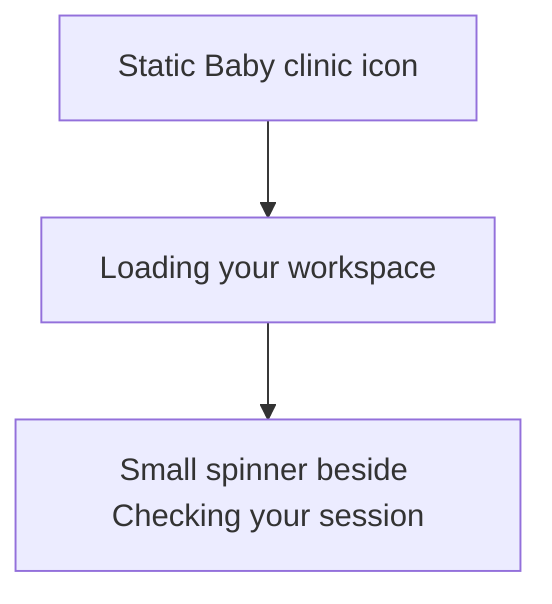

# Implementation Plan: Backend Auth and Session Alignment

Status: **Implemented; automated checks completed, rendered/live verification pending.**

Confirmed loading direction: branded vertical status. User explicitly requested implementation and Impeccable for the affected UI.

Date: 2026-11-10. Revised to include reusable feedback states. Application source was inspected, not changed or tested for this plan.

## Goal

Make the frontend authenticate against the sibling Laravel backend using its actual Sanctum session, resource, pagination, and error contracts. Preserve the existing Zustand session state, TanStack Query integration, layout redirects, stale-response protection, and cross-tab behavior while removing the unsupported refresh-token flow.

## Scope

**Confirmed requirements:** align auth/session and shared `ApiResponse`, `PaginateResponse`, and `MessageResponse`; recommend practical structure improvements; give every feature its own `index.ts`. The user confirmed separate frontend/API origins on the same site and included Audit Logs migration to backend event/date filters, pagination, actor ID, and subject fields.

**Added requirement:** reusable `ErrorState`, spinner-based `LoadingState`, skeleton-based `PendingState` with modal/card/page variants, and `EmptyState`, maximizing existing shadcn components and Tailwind utilities. This revises the proposed scope; it does not approve application implementation.

**Latest visual requirement:** redesign loading as branded vertical status: static clinic icon above the heading and a small spinner beside the status text below; remove the rotating logo ring and glows. Preserve the current light clinic theme. Small inline/table loading states use spinner/text without a forced brand mark.

**Included:** frontend configuration, auth transport and types, affected session consumers/tests, shared response contracts, existing Audit Logs page/service/query/tests, explicit feature exports, reusable feedback states with bounded auth/DataTable adoption, documentation.

**Excluded:** backend changes, new password-change or user-management screens, clinical workflows, broad UI redesign or replacement of every pending indicator, unrelated baseline errors, dependency upgrades, commits, deployment. Preserve the user's `SessionErrorScreen.tsx` heading presentation and wrapper API while composing the new ErrorState inside it. Replace the prior speculative auth envelope normalizer only as part of approved implementation.

## Evidence and current mismatches

The running [Swagger reference](http://localhost:8000/docs#/) and [OpenAPI YAML](http://localhost:8000/docs/openapi.yaml) were fetched read-only. The downloaded YAML exactly matches `../lying-in-clinic-backend/resources/openapi/openapi.yaml`. Relevant schemas are `User`, `UserEnvelope`, `Paginated`, `Error`, `ValidationError`, and `AuditLog`.

Implementation was cross-checked in backend `routes/api.php`, `bootstrap/app.php`, `AuthController`, `AuthService`, `UserResource`, `EnsureActiveStaff`, `AdminController`, `AdminRequest`, `AuditLogResource`, models/migrations, CORS/Sanctum configuration, and `tests/Feature/SecurityBoundaryTest.php`. Installed Laravel paginator/resource source confirms the pagination envelope. Backend tests were read, not executed.

| Concern         | Current frontend                                                 | Backend contract / proposed correction                                   |
| --------------- | ---------------------------------------------------------------- | ------------------------------------------------------------------------ |
| Auth paths      | `/v1/auth/login`, `/refresh`, `/me`, `/logout`                   | `/api/v1/login`, `/api/v1/me`, `/api/v1/logout`; no refresh route        |
| CSRF            | No initialization                                                | `GET /sanctum/csrf-cookie` before login; XSRF cookie/header on mutations |
| User response   | `success`, `message`, `data.user`; accepts several guessed forms | `{ data: { id, name, email, role, active } }`                            |
| User ID         | String                                                           | Numeric integer; keep numeric in session/cache                           |
| User properties | Optional role/name, optional fullName                            | Required name/email, role `admin` or `staff`, boolean active             |
| Logout          | JSON response assumed                                            | HTTP 204, no body; return `void`                                         |
| Protected 401   | Refresh and replay                                               | Expire local session; no refresh call or request replay                  |
| Pagination      | `data.items`, `data.pagination`                                  | Resource collection `{ data: T[], links, meta }`                         |
| Audit request   | limit/search/sort/action/model                                   | page/per_page/from/to/event; fixed descending ID order                   |
| Audit display   | String IDs, nested user names, action/model/createdAt            | Numeric IDs, nullable actor/subject, event/subject_type/occurred_at      |

`EnsureActiveStaff` returns **401** for inactive users or mismatched `auth_version`. Admin authorization returns **403** for an authenticated non-admin. Invalid credentials are **422** with field errors, not an expired-session 401.

The OpenAPI audit schema omits source-level details: `subject_type` can be null, and empty PHP arrays in `old_values`/`new_values` can serialize as `[]`. Preserve those real response possibilities in frontend types; do not invent user names or request private details.

## Approach

Keep one API client and existing session files. Standardize `VITE_API_BASE_URL` as the complete API prefix, such as `http://localhost:8000/api/v1`; feature services then use `/login`, `/me`, `/logout`, and `/audit-logs`. Derive the backend-origin `/sanctum/csrf-cookie` URL from that configured base, avoiding another independent setting for the same host. Document the supported backend-root deployment used here.

Enable `withCredentials`, `withXSRFToken`, and `Accept: application/json`. Keep Axios's XSRF cookie/header names. The CSRF request is explicitly classified as auth transport so pending login/logout does not block it. Initialize CSRF at the start of each explicit login/logout attempt; no automatic mutation retry follows a 419. Keep cancellation/version checks across both CSRF initialization and its following mutation.

Remove `AuthService.REFRESH`, `useRefreshMutation`, refresh promise state, and replay flags. This also removes the existing `axios -> AuthService -> axios` cycle. Axios can still use the narrowly imported session/store helpers for invalidation; those helpers must not import Axios client instances or the auth barrel. No generic transport framework or injected callback registry is needed.

### Shared response contracts

Create `src/types/api.types.ts` and export it from `src/types/index.ts`:

```ts
interface ApiResponse<T> {
  data: T
}

interface MessageResponse {
  message: string
}

interface ValidationErrorResponse extends MessageResponse {
  errors: Record<string, string[]>
}

interface PaginateResponse<T> extends ApiResponse<T[]> {
  links: {
    first: string | null
    last: string | null
    prev: string | null
    next: string | null
  }
  meta: {
    current_page: number
    from: number | null
    last_page: number
    path: string
    per_page: number
    to: number | null
    total: number
    links: Array<{ url: string | null; label: string; active: boolean }>
  }
}
```

These types describe Laravel **resource** responses. Do not model raw `LengthAwarePaginator` JSON, or put `success` and `message` into every successful response. `MessageResponse` describes message bodies, including common errors; it does not substitute for 204. Keep `SafeMutateResult.success` because it is a local outcome discriminator and already handles a `void` result correctly.

Add an exact auth-response schema in `auth.schema.ts`, reusing the existing Zod helpers. Require the actual user fields and positive numeric integer ID, and validate only the documented `{ data: user }` envelope. Unknown extra fields may be stripped for forward compatibility. Missing/wrong fields must fail before session application; no coercion of numeric IDs into strings and no alternative envelope guessing. Infer `AuthUser` from this feature schema and move ownership out of `routes/types.ts`. Keep `SessionResponse = ApiResponse<AuthUser>` as the one shared auth response type, with no duplicate definitions.

### Session and failure behavior

| Event                                                | Proposed behavior                                                                                                                                                                                                               |
| ---------------------------------------------------- | ------------------------------------------------------------------------------------------------------------------------------------------------------------------------------------------------------------------------------- |
| Startup, focus/reconnect, explicit Retry, tab marker | Existing ME query verifies the server cookie; successful `{data:user}` updates cache/store                                                                                                                                      |
| Login success                                        | Apply the validated user, seed the same ME envelope, publish login marker, let layout restore safe return URL                                                                                                                   |
| Login 422                                            | Show backend validation message/field details; remain on login                                                                                                                                                                  |
| Login 419                                            | Show failure; next explicit submission initializes CSRF again                                                                                                                                                                   |
| Logout 204                                           | Clear account query data and user, publish logout, redirect to `/login` without return URL                                                                                                                                      |
| Logout 401                                           | Server already considers the request unauthenticated; complete local logout cleanup                                                                                                                                             |
| Logout 419/network/5xx                               | Report failure and retain session; next explicit logout initializes CSRF again; do not claim server logout succeeded                                                                                                            |
| Protected request 401                                | End the current local session as expired; clear account data, preserve safe return URL, no replay                                                                                                                               |
| Protected mutation 419                               | Surface the failed action, reacquire CSRF, and reconcile through ME without replaying the mutation; ME 401 expires the session, ME success retains it for explicit action retry, and transient ME failure uses the retry screen |
| Protected 403                                        | Show permission error for that operation/page; retain authenticated session                                                                                                                                                     |
| ME timeout/network/5xx, malformed 200                | Existing session error/retry state; preserve known user, block protected content                                                                                                                                                |
| 409/422/429 on other operations                      | Surface backend error; do not globally log out or replay                                                                                                                                                                        |
| Obsolete response/failure after account change       | Cancel/ignore using existing version guard before state/cache changes                                                                                                                                                           |

Avoid double expiration when an interceptor handles ME failure and the boundary observes the same error: let the ME query/boundary own ME reconciliation, while the interceptor handles ordinary protected-request auth failures. Login/logout/CSRF have explicit handling. Reuse `handleSessionFailure` and `endSession` rather than creating another lifecycle owner. Preserve cancellation as cancellation, not as a session error.

A 419 proves a CSRF mismatch, not that authentication expired. Implement its bounded CSRF initialization and ME reset with the existing client/query/session utilities, sharing a recovery promise only if simultaneous failures require it. Do not introduce a CSRF state machine or call back into AuthService from Axios. Preserve the original mutation failure for the caller, guard recovery by session version, exclude CSRF/ME/auth mutations from recursive recovery, and allow Retry to retry failed reconciliation. If CSRF initialization itself fails, expose that failure and permit the recovery to be explicitly retried before any mutation is resubmitted.

Retain mutation serialization, protected-request blocking during auth mutations, account-cache clearing, storage markers without user data, and shell remount by numeric user ID. Auth hooks must admit non-Axios schema errors in their error types rather than claiming every failure is `AxiosError`.

### Audit Logs and structural boundaries

Use endpoint-owned request and row types in `audit-logs.types.ts`. Preserve shared table state (`page`, `limit`) and map it at the audit service boundary to `page`, `per_page`; send only `from`, `to`, and `event` in addition. Continue to use server pagination and previous data while fetching.

Render response `data` rows and `meta.total`. Convert `String(log.id)` only at DataTable's row-key boundary. Show time, actor ID, event, subject type, and subject ID; use a neutral missing-value label for nulls. Do not infer that every null actor represents a named system account. Keep timestamps parsed as backend UTC instants for display. Do not add an audit-detail viewer for old/new values in this scope.

Replace Action/Model controls with exact-event text input and inclusive From/To calendar-date inputs using existing controls. Keep YYYY-MM-DD strings without timezone conversion, enforce date ordering, and explain that backend date filtering uses UTC calendar dates. Disable general search and sortable headers because this endpoint does not support them. Strip stale unsupported query/filter values when restoring old audit URLs; clear unsupported sort/search state without changing reusable table behavior. Do not add backend filters or client-side filtering.

Keep 403 on Audit Logs as an ordinary permission error; backend enforcement remains authoritative. A broader role-aware navigation redesign is deferred.

Every current feature gets a useful, explicit `index.ts`: auth already has a broad barrel, users has an empty barrel, audit-logs has none. Export consumer-facing hooks/types/components from auth and audit-logs and `userRoutes` from users. Do not expose internal session mutation helpers as public APIs. Internal files keep direct sibling imports; low-level Axios imports remain narrow. Keep auth route registration as a direct import: exporting `auth.routes.tsx` through the auth runtime barrel would introduce `Login -> auth barrel -> routes -> AuditLogs -> ...` cycles. A feature barrel requirement does not mean every import must go through it.

### Reusable feedback states

Keep these as four small presentation components directly under `src/components/`, with prop types in `src/types/state.types.ts` and explicit exports from the existing components/types barrels. Do not introduce a state-provider, universal async wrapper, or additional fetching hook. The caller selects the state and owns requests, retries, navigation, and disabled behavior.

Inspected foundations: `LoadingScreen.tsx`, the user-edited `SessionErrorScreen.tsx`, `Empty.tsx` and its public `EmptyProps`, DataTable's inline state markup, and existing `ui/Button.tsx`, `ui/Card.tsx`, `ui/Dialog.tsx`, and `ui/skeleton.tsx`. `shadcn info --json` confirms Base UI, base-nova, Lucide, Tailwind v4; the CLI component list omits several uppercase local files, so filesystem inspection remains authoritative. Spinner, Alert, and registry Empty primitives are absent. During approved implementation, inspect their matching registry output and add only those missing primitives, preserving local casing/import conventions and existing Button/Card/Skeleton. No bulk overwrite or preset reset.

| Component      | Proposed typed contract and defaults                                                                                                                                                                                                                                                                                                      | Composition and ownership                                                                                                                                                                                                     |
| -------------- | ----------------------------------------------------------------------------------------------------------------------------------------------------------------------------------------------------------------------------------------------------------------------------------------------------------------------------------------- | ----------------------------------------------------------------------------------------------------------------------------------------------------------------------------------------------------------------------------- |
| `LoadingState` | `title?: ReactNode` (default `Loading`), `description?: ReactNode`, `size?: 'sm' \| 'md' \| 'lg'` (md), `className?`, `titleClassName?`, `descriptionClassName?`                                                                                                                                                                          | shadcn Spinner beside the status text with optional supporting description; no invented percentage, timeout, full-screen wrapper, or forced brand icon. The session wrapper owns its static clinic mark and heading.          |
| `ErrorState`   | `title?: ReactNode` (default `Unable to load content`), `description?: ReactNode` (default `Please try again.`), `onRetry?: () => void`, `retryLabel?: string` (Retry), `retrying?: boolean` (false), optional decorative `icon?: LucideIcon`, `className?`, `titleClassName?`, `descriptionClassName?`, `headingLevel?: 1 \| 2 \| 3` (2) | Alert composition plus existing Button and Spinner when retrying. Render retry only with a handler; disable it while retrying. Callers pass safe display text, not raw exception objects.                                     |
| `PendingState` | `variant?: 'modal' \| 'card' \| 'page'` (card), `label?: string` (Loading content), `className?`                                                                                                                                                                                                                                          | Existing Skeleton, Card composition where a card surface is appropriate, and Tailwind grid/flex utilities. Deterministic skeleton layouts; no fake text, randomized widths, or focusable placeholders.                        |
| `EmptyState`   | Reuse the complete existing `EmptyProps` API, including size, default/dashed/ghost variants, icon, actions, children, and class-name slots                                                                                                                                                                                                | Compose registry Empty primitives and current Button/action contract. Make `Empty.tsx` a compatibility re-export/facade over this implementation; retain existing `Empty` export/types without maintaining a second renderer. |

Pending variants represent **content shape**, not asynchronous lifecycle or overlay ownership:

- **Modal:** compact title/description bars, stacked field-shaped blocks, and footer/action placeholders. Render inside the caller's existing Dialog/Modal; do not create a dialog, portal, scrim, title semantics, or focus trap. The caller retains a real accessible DialogTitle.
- **Card:** CardHeader placeholders and CardContent rows, using existing Card primitives; do not render extra cards inside arbitrary callers.
- **Page:** responsive heading/toolbar placeholders followed by a main content region; no sidebar, new route, or nested `<main>`. Width is parent-controlled and collapses to one column on small screens.

Keep the established light theme, Nunito/Fraunces typography, semantic tokens, and compact spacing from `DESIGN.md`. Use existing variants before extra classes and Tailwind utilities for layout; no new global CSS animation or unrelated state-specific visual system. Preserve the user-edited **error** heading sizing through explicit props. The previous proposal to retain the loading artwork is superseded by the user's loading redesign request.

The user selected **branded vertical status**. `LoadingScreen` centers a vertical stack on a plain light background: static existing Baby clinic mark, the heading `Loading your workspace`, then a small independent Spinner beside `Checking your session`. Remove the enclosing rotating border, background glow circles, and nested decorative icon tile. Retain clear spacing and the established heading/body fonts; only the small spinner rotates. The wrapper composes LoadingState for the status row. Table and inline LoadingState render spinner/text without the clinic mark or full-screen shell. This is a loading redesign, not an error-screen redesign.

**Bounded integration:**

1. `LoadingScreen` keeps its no-argument public API and session-gating behavior, composing the redesigned LoadingState beneath its static clinic icon and heading within a full-screen container. `SessionErrorScreen({ retry })` keeps its public API, heading hierarchy/presentation, session copy, and retry semantics while composing ErrorState. Auth/Guest layouts and Guard keep deciding which wrapper to render.
2. DataTable uses LoadingState for its existing initial-loading overlay, ErrorState for its default error presentation, and EmptyState for its default empty presentation. Preserve `errorContent`, `emptyContent`, `onRetry`, Clear Filters, retained rows, request disabling, and current initial-loading/refetch precedence. An empty state must not announce a successful empty result beneath a busy/error overlay.
3. Table placeholders remain valid `<tr>/<td>` cells with the current row/column geometry; replace raw pulse bars with the existing Skeleton primitive. Do **not** insert PendingState modal/card/page layouts inside table rows. Preserve the existing retained-row refetch shimmer and veil.
4. Document/render-preview all three PendingState variants without inventing a new modal/card feature or changing unrelated forms. Do not replace mutation-button spinners, global loading stores, or other screens in this pass.

**Accessibility:** LoadingState and PendingState expose one concise polite status announcement; hide spinner artwork and skeleton geometry from assistive technology. Set `aria-busy` on the actual updating content container, with a status message outside any busy subtree that would suppress its announcement. ErrorState has one alert region, not nested alerts from both wrapper and primitive. Keep real headings appropriate to context, visible keyboard focus, and working disabled Retry controls. EmptyState describes an actual empty result; do not repeatedly announce it during refetch. Use reduced-motion utilities for both spinners and skeleton pulse (including the existing Skeleton primitive's default animation), and verify all layouts at mobile width and with long labels. Skeleton variants never become interactive or assert that a real form exists.

## Review visuals

```mermaid
sequenceDiagram
  participant UI as Login / layouts
  participant Auth as auth.query + auth.service
  participant API as lib/axios
  participant Backend as Laravel Sanctum
  participant Session as auth.session + Zustand + ME cache
  UI->>Auth: Explicit login
  Auth->>API: Initialize CSRF
  API->>Backend: GET /sanctum/csrf-cookie
  Backend-->>API: 204 + cookies
  Auth->>API: Login credentials
  API->>Backend: POST /api/v1/login + X-XSRF-TOKEN
  Backend-->>Auth: 200 data: User
  Auth->>Session: Validate and apply current version
  Session-->>UI: Authenticated; layout redirects
  UI->>Auth: Startup / focus / Retry
  Auth->>Backend: GET /api/v1/me with cookies
  alt valid session
    Backend-->>Session: data: User
  else unauthenticated
    Backend-->>Session: 401; end local session
  else temporary failure
    Backend-->>UI: Retry screen; retain known user
  end
```

The proposed flow verifies server cookies through ME. There is no refresh-token endpoint or replay step.



Remove the transport-to-auth-service dependency and keep route registration out of the auth runtime barrel. Shared transport types stay independent of UI prop types.



Callers retain lifecycle and layout control. PendingState offers reusable content placeholders; table rows retain their own geometry.



Confirmed session-loading composition: a centered vertical stack on a plain light background, without the rotating logo ring or glows. Small/table loading states use only the spinner-and-text presentation.

## Steps

1. Recheck working changes and baseline checks before application edits. Preserve user edits and record baseline failures separately. Lock fixtures to the inspected backend shapes and endpoint paths.
2. Add shared response types and auth schema/type ownership. Migrate the ME cache and `applySession` from `data.user` to `data`; update route/store consumers and fixtures together.
3. Align base URL, CSRF initialization, credentials/XSRF headers, exact auth paths, and void logout. Remove unsupported refresh/replay behavior while preserving version and mutation guards. Implement the failure table above.
4. Migrate Audit Logs service/query/page to the actual resource envelope, fields, pagination mapping, and supported filters. Keep table defaults, URL behavior, loading/error presentation, and current query invalidation policy.
5. Replace wildcard auth exports with explicit public exports; populate users and create audit-logs barrels. Migrate safe external imports, check runtime dependency cycles, and keep route/low-level imports direct where necessary.
6. Add the four feedback components and only missing matching shadcn primitives. Preserve the Empty compatibility API, redesign LoadingScreen to the confirmed branded vertical composition, compose the error wrapper without changing its edited heading, and replace DataTable's duplicated default states without altering its custom content slots, pagination, or refetch behavior. Document PendingState variants.
7. Update focused tests and documentation; run checks and browser verification. Record actual evidence, remaining baseline issues, and any deployment configuration still needed. Do not commit or push without authorization.

## Files / modules affected

| Files                                                                                                                                                       | Purpose                                                                                    |
| ----------------------------------------------------------------------------------------------------------------------------------------------------------- | ------------------------------------------------------------------------------------------ |
| `src/types/api.types.ts` (new), `common.types.ts`, `index.ts`                                                                                               | Own and export actual API contracts; remove old generic envelope                           |
| `src/features/auth/auth.schema.ts`, `auth.service.ts`, `auth.query.ts`, `auth.session.ts`, `auth.store.ts`                                                  | Exact user schema, endpoints/CSRF, void logout, cache shape, removal of refresh            |
| `src/features/auth/AuthSessionBoundary.tsx`, `use-session.ts`                                                                                               | Only required reconciliation/error changes; preserve lifecycle ownership                   |
| `src/lib/axios.ts`, `env.ts`, `env.test.ts`, `.env.example`                                                                                                 | Base-prefix contract, XSRF, auth request classification, no replay, documented config      |
| `src/routes/types.ts`, affected route tests                                                                                                                 | Import feature-owned user type and migrate numeric fixtures                                |
| `src/features/auth/index.ts`, `src/features/users/index.ts`, `src/features/audit-logs/index.ts` (new)                                                       | Explicit usable feature exports                                                            |
| `src/features/audit-logs/audit-logs.types.ts` (new), service/query, `src/pages/AuditLogs.tsx`                                                               | Laravel audit rows, parameters, filters and pagination                                     |
| `src/components/layouts/{AuthLayout,GuestLayout}.tsx`, `src/routes/Guard.tsx`, `src/components/Sidebar.tsx`, `src/app/Providers.tsx`, `src/pages/Login.tsx` | Affected public imports and error/void-result consumption only, as needed                  |
| `src/helpers/error.ts`                                                                                                                                      | Typed message/422 field-error extraction only if needed; retain safe fallback behavior     |
| Auth HTTP/session/layout tests; audit service/query tests; env tests                                                                                        | Regression coverage for changed contracts and preserved session guarantees                 |
| `src/features/auth/README.md`, audit/table usage documentation, agent records                                                                               | Current session/backend configuration and migration status                                 |
| `src/components/{ErrorState,LoadingState,PendingState,EmptyState}.tsx` (new), `src/types/state.types.ts` (new)                                              | Small typed presentation components, documented defaults and skeleton variants             |
| `src/components/ui/{spinner,alert,empty}.tsx` (new if still absent), `ui/skeleton.tsx` as needed                                                            | Matching shadcn primitives; reduced-motion support without overwriting existing primitives |
| `src/components/{LoadingScreen,Empty}.tsx`, `src/features/auth/SessionErrorScreen.tsx`, `src/components/datatable/DataTable.tsx`                            | Bounded adoption and compatibility; preserve user-edited heading and existing wrapper APIs |
| `src/components/index.ts`, `src/types/index.ts`, `src/types/empty.types.ts` only if needed                                                                  | Public state exports and compatible existing Empty types                                   |
| `src/components/states.test.tsx` (new), `vitest.config.ts`, existing DataTable/auth tests; `src/components/states.md` (new)                                 | Interaction/semantic regression coverage, narrow test discovery and variant usage examples |

Do not edit ignored local env files automatically. Supply the exact new example values and flag obsolete local values during validation. No Vite proxy is needed for the confirmed separate-origin setup.

## Testing & validation

Automated coverage should prove:

- Login performs CSRF initialization then `/login`, carries credentials/XSRF settings, accepts numeric UserResource fields, and rejects malformed/legacy envelopes before store access.
- ME uses `/me`, never calls refresh, and no protected mutation is replayed after 401/419. Protected 419 recovery verifies both a still-authenticated ME result and an expired ME result, plus CSRF/network failure and explicit recovery retry. Concurrent failures do not repeatedly advance session state or allow old responses into a new account.
- Logout 204 needs no JSON; already-unauthenticated 401 clears locally; 419/network failure remains an honest failed logout. A later explicit attempt starts CSRF initialization again.
- Login 422 preserves backend field messages; 403/409/429 do not log out. ME transient/malformed errors show retry state; retry restores the session on valid response.
- Existing startup, internal return URL, explicit logout, cross-tab login/logout/account replacement, stale response cancellation, queued auth mutation, and cache clearing guarantees remain covered with numeric IDs and real envelopes.
- Audit maps limit to per_page, sends only supported filters, uses data/meta.total, handles nullable actor/subject fields, uses numeric IDs safely, preserves pagination during invalidation, and ignores obsolete URL sort/search/action/model controls.
- All feature barrels expose intended consumers without introducing route initialization cycles. Existing route tests and production bundling exercise initialization.
- State composition preserves auth wrapper APIs and the edited session heading, DataTable override slots/retry/Clear Filters, retained-row shimmer, and valid table skeleton markup. Verify no empty-result announcement while pending or failed.
- ErrorState Retry calls its handler once and respects `retrying`; absent handlers render no dead button. Loading/Pending announce once, decorative skeletons are hidden, and modal PendingState does not create a dialog or nested landmark. Test compatibility of existing Empty props/actions. Avoid brittle class-name snapshots.

Use existing Vitest discovery; new auth tests can live alongside `auth.http.test.ts`. If error-helper-specific tests are added outside current discovery, update `vitest.config.ts` narrowly. Run `npm test`, `npm run typecheck`, `npm run lint`, `npm run check`, and `npm run build`, plus changed-file formatting and `git diff --check`. Report pre-existing failures separately; do not claim historical baseline results as current results.

Browser verification against localhost:8000 is required after implementation: use approved synthetic credentials, verify CSRF cookie/header in real browser traffic, login/reload/logout, two-tab account changes, expired/revoked session, network outage/retry, admin audit filters/pagination, and staff 403. Adapter tests cannot prove browser cookie/CORS behavior. Do not trigger password changes/deactivation against real accounts merely to test revocation; use controlled test fixtures or report the scenario unverified.

Visually verify Error/Loading/Empty and all PendingState variants at desktop and narrow mobile widths, including inside the existing dialog and card primitives. Confirm session loading has a static clinic mark above its heading, a separate small spinner beside status text, and no logo ring/glows; table/inline states must not acquire that brand shell. Check long copy, keyboard Retry, reduced-motion behavior, focus retention, and duplicate screen-reader announcements. Use an isolated temporary preview/test harness rather than adding a public demo route. Planning inspection used source, design records, Impeccable context, and shadcn project info; no rendered-state validation has occurred yet.

## Risks, deployment and compatibility

- Separate origins must remain on the same site. Use `localhost` consistently in development instead of mixing it with `127.0.0.1`. Example API base is `http://localhost:8000/api/v1`; frontend is typically `http://localhost:5173`.
- Deployment needs backend `SANCTUM_STATEFUL_DOMAINS` matching the frontend host/port, exact credentialed `CORS_ALLOWED_ORIGINS`, and a cookie domain compatible with frontend/API subdomains. HTTPS/secure-cookie settings belong to backend deployment configuration. Hostnames remain configurable; none are invented or written into production settings here.
- Existing relative `/api/v1` defaults remain valid for a same-origin deployment, but existing services must no longer append another `/v1`. Audit migration is required in the same change.
- The live schema is corroborating evidence, not proof that every documented nullability is correct. Source-level audit discrepancies are recorded above; no backend schema edit is included.
- Keep authenticated non-admin permission failures distinct from session expiry. This plan does not implement a new permissions framework.
- Cross-tab markers are hints; the backend cookie and ME response remain authoritative. Do not place user or clinical data in localStorage.
- Existing tests encode the obsolete refresh flow and old string IDs; replace those expectations with meaningful Sanctum regressions rather than deleting concurrency coverage.

## Assumptions

- The confirmed separate-origin deployment uses this backend at its origin root, including `/sanctum/csrf-cookie`; API version remains `/api/v1`.
- Existing screen presentation and generic table behavior remain intact except for the explicitly included Audit Logs fields/filters, shared feedback-state composition, and requested loading visual redesign. The user-edited session error heading remains preserved.
- Exact production hostnames and synthetic test credentials are runtime configuration inputs, not unresolved architectural choices.

## Open questions

None remain. Branded vertical loading is confirmed. Implementation was explicitly authorized; the user subsequently prioritized building the UI and deferred authenticated live-browser checks.

## TL;DR

Implemented Laravel Sanctum CSRF/cookie authentication, exact resource/error types, numeric users, void logout, Audit Logs migration, explicit feature barrels and reusable feedback states. Session guarantees, the user's error heading, existing Empty API, custom table slots and refetch behavior are preserved. Automated tests and production build pass; unrelated baseline lint/type/format failures remain. Next action: inspect the isolated preview when browser access is restored and run live cookie/CORS checks when the user resumes authenticated verification.
