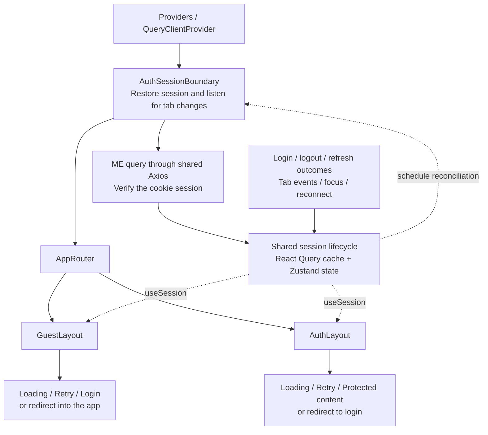
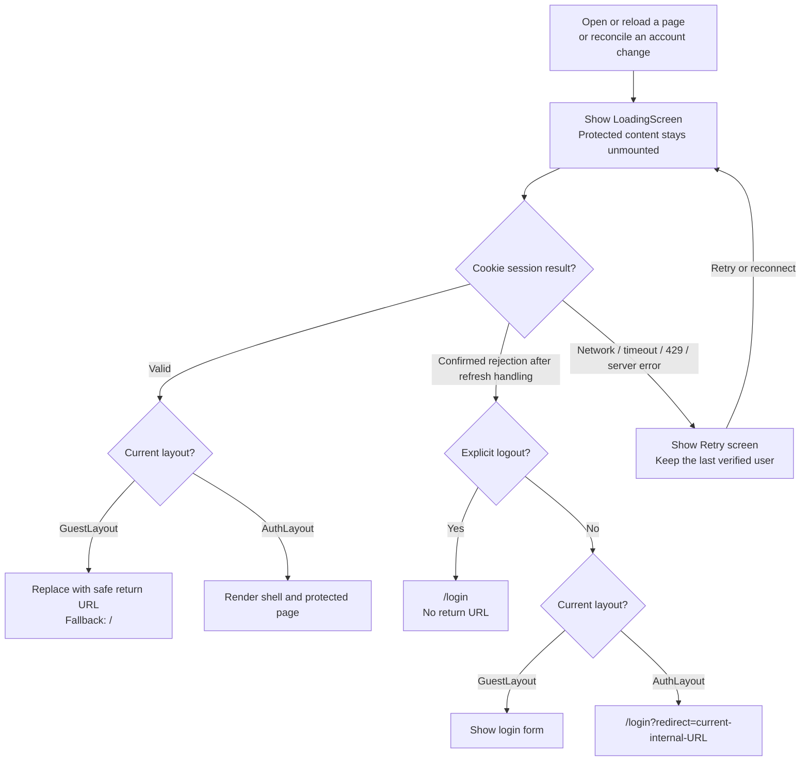

# Implementation Plan: Session Handling and Layout Redirects

Status: implemented and automated validation complete; live browser verification pending. User approved on 2026-10-15.
Date: 2026-10-15 (Asia/Singapore).

Follow-up: the user approved docs/plans/session-simplification.md on 2026-10-15. That implementation replaces the custom orchestration described here while preserving the agreed session behavior. This document remains the original implementation history.

## Visual Review

All diagrams below describe the **approved and implemented** design. Start here for the design; the sections below provide implementation details.

### 1. Who owns what



One boundary manages session checks and browser listeners. The layouts consume the same session state and decide what to render or where to redirect. Login and Sidebar no longer navigate after successful auth mutations.

### 2. What the user sees



Temporary failures never establish that the user is signed out. Successful explicit logout also updates the initiating tab immediately; another tab verifies the latest shared cookie state before applying its redirect.

### 3. How two tabs stay in sync

```mermaid
sequenceDiagram
  participant A as Tab A
  participant API as Auth API / shared cookies
  participant Marker as Browser storage marker
  participant B as Tab B (login or protected page)
  A->>API: Login, logout, or account switch
  API-->>A: Success and updated HttpOnly cookies
  A->>A: Apply session change locally
  A->>Marker: Write unique change ID and reason
  Marker-->>B: storage event
  B->>B: Gate protected content; ignore obsolete work
  B->>API: ME using latest shared cookies
  Note over B,API: Axios performs bounded refresh recovery if needed
  alt Verified authenticated
    API-->>B: Current user
    B->>B: Clear former account cache if identity changed
    B->>B: Apply session; layout renders or redirects
  else Confirmed unauthenticated
    API-->>B: Session rejection
    B->>B: Clear account cache; layout shows login or redirects
  else Temporary failure
    API-->>B: Network or server failure
    B->>B: Retain known user; show Retry
  end
  Note over B,Marker: Received events are not rebroadcast
```

The marker contains no credentials or user data. Tab B verifies the API's current session rather than adopting Tab A's cached user. Focus/reconnect triggers verification if a notification was missed.

## Goal

Restore cookie sessions consistently in GuestLayout and AuthLayout, protect every AuthLayout page, and let session state drive redirects. Synchronize login, logout, expiration, and account changes across tabs while retaining the existing React Query, Zustand, Axios, and React Router architecture.

## Confirmed Requirements

- Both layouts restore the cookie session on reload and display LoadingScreen while resolving it.
- All AuthLayout children require authentication.
- Cross-tab synchronization covers login, logout, and account changes; a tab on /login must also respond.
- GuestLayout returns authenticated users to their original internal URL, with / as fallback. Explicit logout navigates to /login without a return URL.
- Layouts own redirects; remove explicit auth navigation from Login and Sidebar.
- Network failures and server outages retain the known session and display a retry screen. Only confirmed session rejection signs the user out.
- Keep the design simple and scalable; application implementation is not yet authorized.

## Current Behavior and Evidence

- GuestLayout only observes isAuthenticated, displays a debug toast, and logs state.
- AuthLayout calls useCurrentUserQuery but only gates initial loading; errors can render protected children.
- Zustand starts unauthenticated on every reload, without distinguishing an unchecked session from a rejected session.
- Login/refresh mutations cache a bare AuthUser; ME caches ApiResponse<{ user: AuthUser }>. Their query key is identical.
- Login and Sidebar navigate directly. Axios logs out and hard-navigates on every refresh failure, including temporary failures.
- RouteGuard supports authentication and custom predicates, but current layout routes do not enable requireAuth. A guard outside session initialization could redirect too early.
- No cross-tab signaling exists. React Query defaults may refetch stale data on focus/reconnect, but this alone does not synchronize session transitions.
- Read-only inspection of inventory-server confirmed login/refresh return user data and set HttpOnly cookies, ME returns the current user, and logout clears cookies. No server changes are planned.
- Existing working changes in GuestLayout, Login, and Sidebar must be preserved except for auth behavior explicitly superseded by this plan.

## Scope

**In scope:** session lifecycle, current-user cache consistency, query/mutation integration, Axios refresh failure handling, both layouts, one shared session boundary/listener, existing login/logout consumers, guard initialization compatibility, targeted tests, and documentation.

**Out of scope:** backend changes, cookie/token redesign, persistent user/token storage, proactive refresh timers, refresh locking across tabs, new permission rules, asynchronous custom-guard redesign, visual layout redesign, unrelated table work, and existing type/format cleanup.

## Approach

Use one shared session boundary inside QueryClientProvider, above the router, to initialize and reconcile the session and own the cross-tab listener. Keep its implementation in the auth feature. Both layouts consume a small useSession hook and render loading, retry, redirect, or content according to the resolved session state.

Keep React Query as the server-data cache and Zustand as the local session state used by existing consumers. Add explicit session resolution state rather than treating the initial false isAuthenticated value as a confirmed logout. Session operations update the cache/store through a small shared lifecycle module so mutations, the interceptor, and incoming tab events use the same rules. Preserve existing mutation callback contracts and avoid router imports in auth services or Axios.

Use a namespaced localStorage change marker with a unique event ID and change reason. Its storage event reaches other tabs; the initiating tab updates locally. Messages carry no user data or credentials. Receiving tabs reconcile against ME and shared cookies rather than trusting an event as proof of authentication. Focus/reconnect checks cover missed events and environments where storage is unavailable. This avoids a new library or multiple competing transports.

## State and Redirect Contract

Session resolution distinguishes checking, authenticated, unauthenticated, and temporary error. Retain the last verified user on a temporary error; layouts gate children behind the retry screen until verification succeeds. Keep user/isAuthenticated consistent for existing consumers, while layouts use the explicit resolution state.

| Situation                               | GuestLayout                         | AuthLayout                                          |
| --------------------------------------- | ----------------------------------- | --------------------------------------------------- |
| Initial check or account reconciliation | LoadingScreen                       | LoadingScreen; do not mount protected children      |
| Verified authenticated                  | Replace with safe return URL or /   | Render existing shell and Outlet                    |
| Confirmed unauthenticated               | Render login Outlet                 | Replace with /login?redirect=<current internal URL> |
| Explicit logout, including another tab  | Render login Outlet                 | Replace with /login, without return URL             |
| Temporary verification/refresh failure  | Retry screen, preserving known user | Retry screen, preserving known user                 |

- Preserve pathname, search, and hash for return navigation. Accept same-origin internal destinations; reject external/protocol-relative URLs, malformed values, and login destinations that would loop. Fall back to /.
- On account change, hide old protected content, cancel/remove old account queries, reconcile the new user, then retain the current protected URL. Existing permission guards may deny the new user access.
- Treat the initial ME 401 as refreshable. A failed refresh with 401, or ME still returning 401 after its single retry, confirms session rejection. Ordinary endpoint 403 responses remain permission errors rather than global logout signals.
- Network errors, timeouts, 429 responses, and server errors are temporary failures, not evidence of logout. Failed login and failed explicit logout retain their existing form/toast error reporting; unsuccessful logout does not broadcast success.
- Expiration discovered through verification or a protected request uses the return URL policy. No exact-expiry timer is introduced.

## Steps

1. **Establish the shared session contract.** Extend auth.store.ts with explicit resolution state and logout cause while preserving existing user/isAuthenticated consumers. Add auth.session.ts for applying verified users, rejecting sessions, retaining temporary errors, and advancing a session generation on invalidating transitions. Keep browser signaling behind a small feature-local interface.
2. **Unify cache and request lifecycle.** Make authKeys.me() consistently cache ApiResponse<{ user: AuthUser }>, including login and refresh. Move unconditional store writes out of the ME query function so canceled/obsolete responses cannot restore auth. Give session requests an AbortSignal where applicable and guard commits using the current session generation. Wire login/logout/refresh callbacks into shared transitions without dropping caller callbacks. Cancel old queries and clear account data before accepting another identity; retain the current full-cache logout clearing behavior.
3. **Keep Axios responsible for HTTP recovery.** Preserve credential handling, one refresh per tab, queued retries, and endpoint exclusions. Remove console debugging and window.location navigation. Ensure each queued original request also retries at most once. Classify refresh failures centrally, reject every queued request correctly, and notify the shared lifecycle on confirmed rejection or temporary refresh failure. Do not broadcast ordinary successful refreshes or temporary failures. Avoid auth-barrel imports that create module cycles.
4. **Mount session initialization and synchronization once.** Add AuthSessionBoundary.tsx and use-session.ts in the auth feature and mount the boundary in app/Providers.tsx inside QueryClientProvider. Initialize ME once per page load and share that result between layouts. Publish successful login/logout and detected identity/session rejection changes. On incoming storage events, gate protected content and reconcile the latest cookie session; do not rebroadcast received events. Reconcile on focus/reconnect, coalesce duplicate checks, clean up listeners, and tolerate unavailable storage. Keep latest-state checks/generation guards so delayed events or responses cannot reverse newer transitions. Scope bootstrap to the shared application boundary without putting redirect logic there.
5. **Make layouts control access and navigation.** GuestLayout replaces its debug effect with loading/error/anonymous/authenticated rendering. AuthLayout gates its existing shell and Outlet on verified authentication, preserving sidebar, atmosphere, breadcrumb, metadata, and header behavior. Share a small session retry presentation using current UI primitives. Centralize safe return-URL construction/validation in an auth helper. Remove successful-login navigation from Login and successful-logout navigation from Sidebar, preserving form errors, pending state, and mobile-sidebar closing.
6. **Retain guard compatibility.** Update RouteGuard to respect unresolved/error session state before evaluating authentication/custom predicates. Keep requireAuth and custom guards available for routes outside AuthLayout; AuthLayout itself protects all descendants without adding flags to every child. Do not broaden guard capabilities or alter unrelated routes.
7. **Validate and document.** Add focused behavioral tests using the existing Vitest/React DOM/happy-dom conventions, extend discovery for new auth tests, document session ownership and cross-tab behavior, run configured checks, and record evidence and remaining limitations.

## Files / Modules Affected

- src/features/auth/auth.store.ts: explicit resolution and logout cause.
- src/features/auth/auth.query.ts: consistent cache shape, lifecycle integration, stale-response protection.
- src/features/auth/auth.service.ts: optional cancellation for session verification; endpoint/cookie contract unchanged.
- src/features/auth/auth.session.ts (new): shared transitions and cross-tab change marker helpers.
- src/features/auth/use-session.ts (new): layout-facing session/retry access.
- src/features/auth/AuthSessionBoundary.tsx (new): one bootstrap and browser event owner.
- src/features/auth/auth.redirect.ts (new): safe return destinations and login URL creation.
- src/features/auth/index.ts: appropriate public exports; low-level modules use direct imports to avoid cycles.
- src/app/Providers.tsx: mount the boundary within query context.
- src/lib/axios.ts: refresh outcome reporting and bounded retries; remove hard redirect.
- src/components/layouts/GuestLayout.tsx and AuthLayout.tsx: session-based rendering and declarative redirects.
- src/features/auth/SessionErrorScreen.tsx (new): shared accessible retry presentation.
- src/pages/Login.tsx and src/components/Sidebar.tsx: remove duplicate auth navigation only.
- src/routes/Guard.tsx: initialization/error compatibility.
- src/features/auth/_.test.{ts,tsx}, src/routes/_.test.tsx, and vitest.config.ts: focused test coverage/discovery; test interceptor behavior through the shared Axios instance.
- docs/plans/session-layouts.md and docs/agent/{requirements,decisions,roadmap}.md: approved contract, progress, and validation.

## Testing & Validation

- Cold load with valid cookies on login and protected deep links; loading appears before the outcome and protected child effects do not run early.
- Cold load with no session; login renders and protected links retain a safe return destination.
- Login redirect, authenticated visits to login, explicit logout with no return URL, and no redirect loops/history bounce. Include unsafe, encoded, query-string, and hash destinations.
- Consistent ME cache shape after login, manual refresh, interceptor refresh, and normal verification; caller mutation callbacks still execute.
- Expired access cookie with valid refresh succeeds. Rejected refresh signs out once. Concurrent 401s settle the queue and every request has a bounded retry.
- Network/timeout/429/5xx failures preserve the known session, show Retry, and recover without forcing login. Ordinary 403 permission failures do not log out.
- Login/logout/account-change events affect a tab on /login as well as a protected tab. No echo loops or credential/user payloads; duplicate and delayed events converge on the server's current identity.
- Logout/account change while ME or protected requests are pending cannot restore the previous account or display its cache. Listener cleanup and storage-unavailable behavior are covered.
- Guarded deep links wait for initialization; existing custom synchronous guard behavior remains intact.
- Run npm test, npm run typecheck, npm run lint, npm run check, npm run build, edited-file formatting, and git diff --check. Separate existing failures from regressions; historical records report casing/navigation type errors and widespread formatting issues, which must be rechecked rather than assumed unchanged.
- Manually verify in two same-origin browser tabs against the running backend: restoration, login, logout, account switch, access refresh, offline/retry, focus/reconnect, and Back navigation. Mocked tests do not establish live browser/cookie behavior.

## Risks & Edge Cases

- Shared cookies mean account changes affect every tab; never trust cached data from the former identity after reconciliation begins.
- A canceled browser request can still complete server-side. Guard local state/cache commits and do not claim to undo server cookie effects. Serialize local auth transitions where needed, then reconcile the authoritative cookie session after competing changes.
- Simultaneous refreshes in separate tabs remain possible because cross-tab refresh locking is out of scope. The inspected backend verifies refresh tokens without a one-use token store; verify real concurrent behavior during the browser check.
- Storage may be disabled and background tabs may delay events. Focus/reconnect reconciliation provides eventual recovery; immediate background synchronization requires browser event delivery.
- Global listeners must not redirect or import the router. Axios must not import the auth feature barrel or query hooks, avoiding existing cyclic dependencies.
- Global bootstrap may also check the session on the standalone NotFound route; that route's display/navigation is unchanged and does not become protected.

## Assumptions and Implementation Proposals

- No new runtime dependency is needed; use localStorage storage events rather than BroadcastChannel plus a fallback transport.
- Account-change reconciliation retains the current protected URL; existing authorization decides whether the new identity can use it.
- Session checks are event-driven (startup, relevant tab event, focus/reconnect, request recovery, and Retry), without polling or proactive expiry timers.
- Keep transient login/logout mutation errors in their existing caller UI; retry screens apply to session verification and refresh failures.
- Add targeted automated auth tests because access gating, request races, and cross-tab behavior need regression coverage. No unrelated tests or cleanup are included.

## Open Questions

None blocking the proposed plan. The implementation proposals above are presented for approval, not recorded as separately confirmed user requirements.

## Approval Gate

The user explicitly approved this plan on 2026-10-15. Implementation and automated validation are complete; no new approval is needed for the completed scope.

## Implementation and Validation Record

- Shared lifecycle, boundary, retry hook/screen, safe redirect helpers, layout gates, cross-tab signaling, generation guards, and refresh recovery are implemented. Login and Sidebar retain error/pending behavior and delegate successful navigation to layouts. Existing breadcrumb tests now establish a verified session fixture.
- The protected shell is keyed by user ID so an account change remounts page state after old queries are removed. Consumed logout causes are cleared on the login page so later protected visits can capture a new return URL.
- Account transitions clear query data and settled mutations. Pending mutations remain until settlement so TanStack's shared auth scope can resume queued actions; immediately clearing MutationCache would strand queued login/logout actions. Regression tests cover that sequence. Obsolete HTTP responses cannot commit account data.
- Automatic refresh is shared per session generation. New-session requests never join an old generation's pending refresh. Received tab changes suppress rebroadcast, including when Axios handles refresh rejection.
- Passed: all 131 tests (42 new auth tests plus 89 existing tests), full ESLint, production build, formatting for all edited source and the plan, and git diff --check. Build retains its large-chunk warning.
- Typecheck reports the existing assertion at src/routes/navigation.test.ts:15, which expects /pos in the application route union. No new TypeScript errors remain. Full npm run check reports repository formatting issues outside the edited implementation source; no unrelated cleanup performed.
- Live authenticated browser/API and actual two-tab smoke checks were not performed. Tests use simulated storage/focus/reconnect events and mocked services or Axios adapters. Browser event delivery and live cookie behavior remain the verification boundary.
- Runtime ownership and integration notes are in src/features/auth/README.md. No backend edits, new dependencies, or commits were made.

## TL;DR

- **One session owner:** a shared boundary restores cookies and listens for tab changes.
- **Two simple layouts:** both show Loading or Retry; AuthLayout protects every child and GuestLayout redirects signed-in users.
- **Automatic navigation:** login returns to the original safe internal URL; explicit logout goes to /login without a return URL.
- **Tabs stay aligned:** login, logout, and account changes trigger verification in other tabs; old account caches are cleared.
- **Failures stay recoverable:** temporary outages preserve the known session; confirmed rejection signs out. Outdated responses cannot restore an old local session.
- **Status:** implemented; all 131 tests, lint, build, and edited-source formatting pass. Existing route type/formatting issues remain. Next: verify the real login, refresh, logout, offline recovery, and two-tab flows against the running backend.
