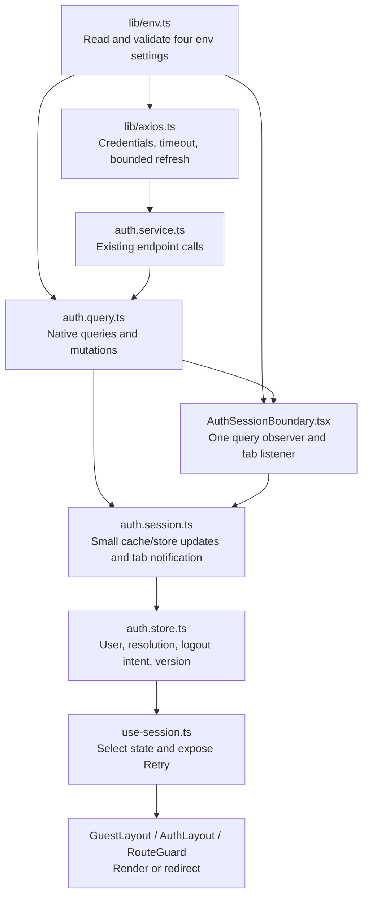

# Implementation Plan: Simplify Session Handling

Status: approved on 2026-10-15; implementation and automated validation complete. Live browser verification remains pending.
Date: 2026-10-15 (Asia/Singapore).
Related: session-layouts.md records the previous implementation; this approved simplification replaces its session orchestration.

## Goal

Keep Zustand and the agreed session behavior while replacing the custom session orchestration with native React Query hooks and a small shared set of updates. Make the responsibilities of every affected file clear before changing application code.

## Confirmed Requirements

- User considers the current implementation overengineered and requests a simpler approach and file/purpose proposal before refactoring.
- Keep Zustand; the user declined moving session state entirely into React Query.
- Latest implementation constraints: optimize through fewer redundant requests, listeners, state updates and branches; keep control flow straightforward; maximize reuse of existing files. Introduce an extracted abstraction only when a function becomes too long to follow, rather than adding speculative layers or wrappers.
- Keep VITE_API_BASE_URL and add VITE_API_TIMEOUT_MS=15000, VITE_AUTH_STALE_TIME_MS=300000, and VITE_AUTH_SYNC_TABS=true.
- Existing behavior remains required: cookie restoration in both layouts, protected AuthLayout children, automatic safe return redirects, explicit logout without a return URL, cross-tab login/logout/account changes, and temporary-error Retry without clearing the known user.
- User explicitly approved this refined proposal on 2026-10-15, authorizing implementation and env configuration.

## Proposed Design



Arrows show responsibilities/data flow rather than an import graph: services continue calling the shared Axios instance. React Query owns requests, errors, cancellation and mutation scheduling. Zustand owns the local user and access state consumed by layouts. The boundary observes the existing current-user query rather than maintaining another fetch scheduler.

## What Gets Simpler

Keep related operations together in existing query hooks, store actions and the boundary. Do not introduce generic runners, registries, callback chains or forwarding-only helpers. Review the resulting code for direct readability as well as preserved behavior. The new env module is the shared configuration entry point; otherwise prefer existing files. Any extraction must address a concrete function that has become too long to read comfortably.

| Current mechanism                                           | Proposed replacement                                                                        |
| ----------------------------------------------------------- | ------------------------------------------------------------------------------------------- |
| Global mutation counts and deferred-check flags             | Native useIsMutating plus enabled/query invalidation                                        |
| Custom requestSessionCheck/subscribeSessionChecks event bus | One mounted current-user query with native invalidation/refetch                             |
| runSessionMutation wrapper                                  | Ordinary auth mutation callbacks with their existing shared scope                           |
| Retry context/provider                                      | use-session obtains QueryClient and refetches the current-user query                        |
| Global generation and remote-generation coordination        | One session version in the store for obsolete HTTP responses; incoming events never publish |
| Raw errors copied into Zustand                              | React Query keeps request errors; store retains the small resolution status used for gating |
| Hard-coded request/session options                          | Validated env values read in one module                                                     |

Keep the useful protections: cancel obsolete queries, guard old HTTP responses, clear old account queries, serialize auth mutations, bound refresh retries, and validate return URLs. Removing those would change the behavior already agreed, rather than merely simplify its implementation.

## Files and Their Purpose

### Configuration

| File           | Action         | Single purpose                                                                                                                    |
| -------------- | -------------- | --------------------------------------------------------------------------------------------------------------------------------- |
| src/lib/env.ts | Add            | Parse/validate env strings once and export typed application settings with defaults.                                              |
| .env.example   | Update         | Document the four public settings and their units/defaults.                                                                       |
| .env           | Update locally | Add the three confirmed settings, preserving the existing API URL and all unrelated local values; never commit this ignored file. |

### Session and HTTP

| File                                      | Action               | Single purpose                                                                                                                                                                                                                               |
| ----------------------------------------- | -------------------- | -------------------------------------------------------------------------------------------------------------------------------------------------------------------------------------------------------------------------------------------- |
| src/features/auth/auth.store.ts           | Simplify             | Store user/access status and logout intent. Retain one version counter for stale-response protection; remove the copied raw error. Keep existing user/isAuthenticated consumers compatible.                                                  |
| src/features/auth/auth.query.ts           | Simplify             | Define auth keys, current-user query and ordinary login/logout/refresh mutations. Apply shared updates after success, preserve caller callbacks, and use configured freshness.                                                               |
| src/features/auth/auth.session.ts         | Shrink substantially | Shared cache/store updates and a small tab-change publisher. Remove its event bus, pending counters, deferred flags, generic mutation runner, and remote-generation state.                                                                   |
| src/features/auth/AuthSessionBoundary.tsx | Simplify             | Observe useCurrentUserQuery, synchronize its result/status, and own one storage listener. Use native mutation/query state to defer checks during auth mutations. Use query focus/reconnect options instead of a custom fetch scheduler.      |
| src/features/auth/use-session.ts          | Simplify             | Select session state and expose current-user refetch for Retry, with no React context.                                                                                                                                                       |
| src/lib/axios.ts                          | Simplify             | Send credentials, apply configured timeout, share one refresh for the current session version, retry once and reject stale responses. Keep endpoint calls in AuthService and auth keys in the auth feature; avoid loading its public barrel. |
| src/features/auth/auth.redirect.ts        | Keep                 | Validate internal return URLs and construct the login destination. This small helper protects against redirect loops and external destinations.                                                                                              |
| src/features/auth/SessionErrorScreen.tsx  | Keep                 | Present the existing generic Retry UI; session logic stays outside the component.                                                                                                                                                            |

### Integration Files

| File                                   | Action                           | Purpose in the final design                                                                                   |
| -------------------------------------- | -------------------------------- | ------------------------------------------------------------------------------------------------------------- |
| src/components/layouts/GuestLayout.tsx | Adjust                           | Render checking/error/login states or redirect authenticated users. Keep the current return-URL policy.       |
| src/components/layouts/AuthLayout.tsx  | Adjust                           | Gate protected content and redirect signed-out users. Preserve the existing shell and identity-based remount. |
| src/routes/guard.tsx                   | Adjust                           | Consume the simplified session state before applying existing authentication/custom guards.                   |
| src/app/Providers.tsx                  | Keep                             | Already mounts the single boundary inside QueryClientProvider.                                                |
| src/features/auth/auth.service.ts      | Keep                             | Already owns endpoint calls and forwards cancellation for ME.                                                 |
| src/features/auth/index.ts             | Keep/adjust exports if necessary | Maintain the existing auth public imports.                                                                    |
| src/pages/Login.tsx                    | Keep                             | Already submits credentials and delegates successful redirects to GuestLayout.                                |
| src/components/Sidebar.tsx             | Keep                             | Already submits logout and delegates the redirect to AuthLayout.                                              |

auth.routes.tsx, auth.schema.ts, shared QueryClient defaults, backend files, and unrelated UI are outside the refactor.

### Tests and Records

| File                                                 | Action                             | Purpose                                                                                                                                               |
| ---------------------------------------------------- | ---------------------------------- | ----------------------------------------------------------------------------------------------------------------------------------------------------- |
| src/features/auth/auth.session.test.ts               | Adapt                              | Preserve behavioral coverage for state/cache cleanup, tab messages, safe redirects and obsolete results; remove tests for deleted orchestration APIs. |
| src/features/auth/auth.http.test.ts                  | Adapt                              | Verify credentials, timeout integration, bounded/shared refresh, temporary errors, and stale-response protection.                                     |
| src/features/auth/auth.layouts.test.tsx              | Adapt                              | Verify restoration, redirects, Retry, two-tab events, account changes, mutation ordering and listener cleanup through the simpler design.             |
| src/lib/env.test.ts                                  | Add                                | Verify numeric/boolean parsing, defaults and invalid configuration reporting.                                                                         |
| src/routes/breadcrumbs.test.tsx                      | Adjust only if fixtures require it | Preserve the verified-user fixture and breadcrumb behavior.                                                                                           |
| vitest.config.ts                                     | Update                             | Discover the new env tests without changing unrelated suites.                                                                                         |
| src/features/auth/README.md                          | Update                             | Document the simplified ownership and env settings.                                                                                                   |
| docs/plans/session-simplification.md                 | Maintain                           | Reviewable proposal, approval status and later validation record.                                                                                     |
| docs/plans/session-layouts.md                        | Annotate after approval            | Preserve the original history and link the replacing design.                                                                                          |
| docs/agent/requirements.md, decisions.md, roadmap.md | Maintain                           | Record requirements, accepted design, work status and evidence.                                                                                       |

No runtime file is deleted merely to reduce the file count. The intended reduction is in mechanisms and branching, with each retained file having a clear purpose.

## Environment Settings

```dotenv
VITE_API_BASE_URL=http://localhost:3000/api
VITE_API_TIMEOUT_MS=15000
VITE_AUTH_STALE_TIME_MS=300000
VITE_AUTH_SYNC_TABS=true
```

| Setting                 | Effect                                                                                                                                                     |
| ----------------------- | ---------------------------------------------------------------------------------------------------------------------------------------------------------- |
| VITE_API_BASE_URL       | Existing API base; preserve its current local value and /api/v1 fallback.                                                                                  |
| VITE_API_TIMEOUT_MS     | Positive finite request timeout in milliseconds; default 15000.                                                                                            |
| VITE_AUTH_STALE_TIME_MS | Non-negative finite session-query freshness in milliseconds; default 300000 (five minutes). Not the server session/token lifetime.                         |
| VITE_AUTH_SYNC_TABS     | Explicit true/false parsing, default true; controls cross-tab publishing/listening. Startup restoration and regular focus/reconnect checks remain enabled. |

Use configured freshness for normal query reuse and focus checks. Startup restoration, Retry, and received tab changes still force verification; a fresh cache must not bypass an account change. Invalid supplied values produce a clear configuration error rather than silently interpreting false as truthy or accepting NaN. VITE settings are public build-time values, with no credentials or tokens added.

## Steps

1. Add env parsing/tests and document confirmed settings; wire timeout and query freshness.
2. Simplify the store and shared session updates, preserving the small stale-response guard and cache cleanup.
3. Replace custom orchestration with native query/mutation state; remove retry context and redundant listeners/scheduling.
4. Reconnect layouts/guards without changing redirect or retry behavior, then adapt existing regression tests.
5. Run checks, update documentation and record browser-validation limitations.

## Testing and Validation

Retain the existing session scenarios instead of replacing behavior tests with implementation-shaped tests. Verify cookie restoration, login/logout/refresh, guarded deep links, safe return URLs, network/429/server failures, old responses after logout, account cache cleanup, queued mutations, cross-tab messages without echo, storage unavailable, and focus/reconnect. Add direct env parsing cases and verify that staleTime does not suppress forced checks.

Run npm test, typecheck, lint, check, build, edited-file formatting and git diff --check. Current implementation passed 131 tests, lint and build; known baseline limitations are the /pos assertion in navigation.test.ts and repository-wide formatting issues. Actual two-tab/live backend checks remain distinct from simulated tests.

## Risks and Boundaries

- A single session version remains necessary to reject requests from the former account; simplification must not allow stale cache repopulation.
- Clearing pending mutations would break the shared auth scope; keep pending actions until they settle and remove old query/settled data at transitions.
- Disabling explicit tab signals still permits eventual reconciliation on focus/reconnect because tabs share cookies.
- The new 15-second timeout is an intentional configured behavior change. Env freshness never changes backend cookie validity.
- Preserve prior user edits and avoid backend changes, new runtime dependencies, unrelated formatting, route redesigns or additional session frameworks.

## Assumptions

- Existing approved session behavior remains in scope because the user requested simplification, not different access/redirect behavior.
- Retain the current filenames where useful rather than introducing a renamed provider or a new sync abstraction.

## Open Questions

None. The user confirmed keeping Zustand and the four env settings, then explicitly approved the refined implementation proposal.

## Implementation Record

- Reused all existing auth files. Removed the custom event bus, global mutation counters, generic mutation runner, remote-generation bookkeeping, retry context and copied store error. Ordinary mutations retain their shared scope and caller callbacks; native query/mutation state handles waiting and refetch.
- The boundary now observes useCurrentUserQuery and owns one storage listener. Native React Query handles focus/reconnect and request coalescing. Fresh focus checks reuse data; startup, incoming tab changes and Retry force verification. Retry keeps protected children blocked while a retained user is being verified.
- Zustand owns one version counter for old-response rejection. Shared session helpers update state/cache and publish tab markers; incoming verification does not publish. Signed-out ME cache is null, otherwise the existing response envelope. Account query data is cleared except the active ME query; mutations remain under native scheduling/garbage collection rather than manual getMutationCache traversal.
- Added lib/env.ts and env.test.ts, updated .env.example, and added the three approved settings to the ignored local .env without changing its API URL or printing unrelated values. No dependencies or backend files changed.
- Removed tests for the deleted orchestration APIs and kept behavioral coverage. Added env parsing/default/error cases, fresh-cache and forced-check cases, disabled tab sync, stale login after a tab change, failed logout, delayed Retry and actual Axios refresh failure within the boundary.
- Validation passed: all 147 tests across 11 files, full lint, production build, edited-source/documentation formatting and git diff --check. Typecheck still reports only the existing /pos route-union assertion in src/routes/navigation.test.ts:15; full formatting reports 72 existing repository issues. Build retains the large-chunk warning. Actual browser/API two-tab verification remains unperformed; service/adapter and simulated-event tests do not establish live cookie behavior.

## TL;DR

Implemented using Zustand, existing files, native React Query scheduling and one tab listener. The event bus, mutation counters, generic runner and retry context are gone. Four typed env settings control API URL, timeout, session freshness and tab sync. All 147 tests, lint, build and edited-file formatting pass. Existing route-type/repository-formatting issues remain; next: verify live two-tab/cookie flows against the backend.
