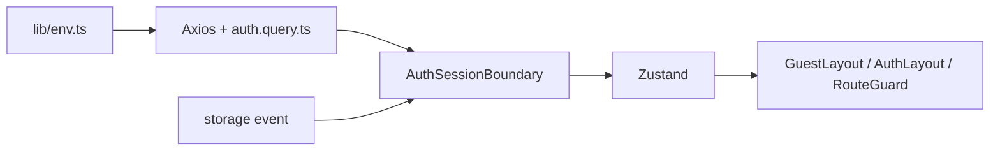

# Session handling

`Providers` mounts one `AuthSessionBoundary` inside QueryClientProvider. Zustand holds the user and access status. React Query handles fetching, errors, freshness, cancellation and mutation scheduling. The application and Axios share the QueryClient in `src/lib/query-client.ts`.

## Configuration

| Variable                | Default | Purpose                                                          |
| ----------------------- | ------- | ---------------------------------------------------------------- |
| VITE_API_BASE_URL       | /api/v1 | API base; local .env.example uses http://localhost:3000/api.     |
| VITE_API_TIMEOUT_MS     | 15000   | Positive request timeout in milliseconds.                        |
| VITE_AUTH_STALE_TIME_MS | 300000  | Non-negative query freshness, not cookie/token lifetime.         |
| VITE_AUTH_SYNC_TABS     | true    | Enable explicit tab publishing/listening; accepts true or false. |

`src/lib/env.ts` parses these public build-time settings once. Invalid supplied values identify the setting in a startup validation error. Update `.env` and restart Vite when changing configuration.

## Ownership

- `auth.store.ts` holds user, status, isAuthenticated, logoutCause and one version for obsolete HTTP responses. It does not duplicate request errors.
- `auth.query.ts` exposes parameterless hooks with internal query settings and mutations sharing one native scope. Successful actions update the session/cache and announce login/logout. The current-user query waits for auth mutations and verifies on mount. `authKeys.me()` contains the API response envelope, or null for a confirmed signed-out session.
- `auth.session.ts` holds shared cache/store updates and the tab marker helpers. There is no custom event bus, mutation counter, fetch scheduler or remote-generation state. Account queries are removed on logout/account change; pending mutations remain managed by TanStack so queued actions can finish. Mutation records follow native garbage collection rather than manual cache traversal.
- `AuthSessionBoundary.tsx` observes `useCurrentUserQuery`, waits for native auth mutation state, and owns one storage listener. It never rebroadcasts received changes. React Query handles focus/reconnect checks for stale sessions. Startup, Retry and incoming tab changes force verification even when data was fresh.
- `use-session.ts` exposes the Zustand state and current-user refetch for Retry, using the application QueryClient directly. No retry context/provider is needed.
- `axios.ts` sends credentials, enforces the configured timeout, shares automatic refresh per session version and replays each protected request at most once. It rejects responses from obsolete versions before they can populate query caches. Auth mutations do not recursively trigger refresh.
- Layouts own redirects and access gating. Login/Sidebar submit their mutations and handle caller errors. AuthLayout remounts protected page state when the user ID changes.

## Behavior

Both layouts show Loading while restoring/reconciling the session. Temporary verification/refresh failures retain the known user behind Retry; protected children stay blocked until verification finishes. Confirmed session rejection signs out; ordinary endpoint 403 responses remain permission failures.

GuestLayout accepts a validated internal return URL, falling back to `/`. Expiration preserves pathname, search and hash. Explicit logout goes to `/login` without a return URL; the consumed cause is cleared there so a later protected visit captures a new destination.

Other tabs receive only a unique ID and reason via `inventory:session-change`, then verify the shared HttpOnly cookies. No user data or credentials are stored in the marker. Tab changes reset the query, including while auth mutations temporarily disable it; native query scheduling verifies the final cookie state after those actions settle. If tab signals are disabled or storage is unavailable, stale sessions still reconcile on focus/reconnect.

There is no polling, exact-expiry timer or cross-tab refresh lock. Cancellation cannot undo cookie writes already performed by the server. Tests simulate storage/focus/reconnect and mock services/adapters; live two-tab browser checks remain necessary to validate actual event/cookie behavior.
